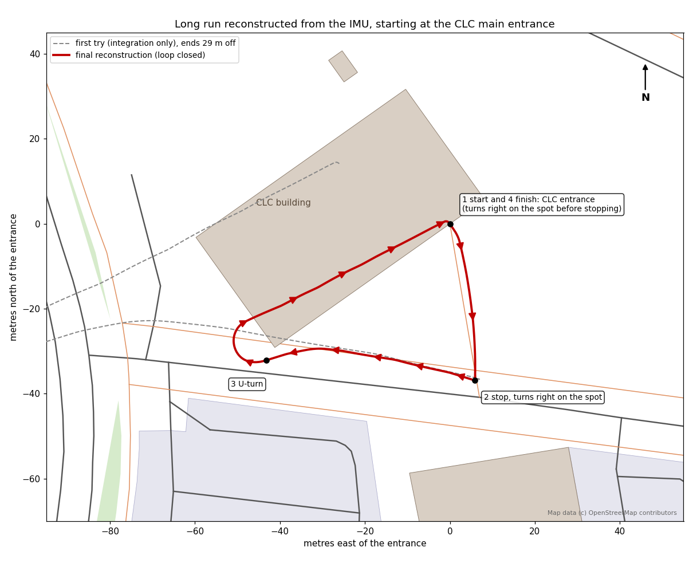

# IMU → movement: where did the robot go?

An Xsens MTi IMU on a small robot recorded acceleration, rotation rate and
magnetic field at 10 Hz. From these two recordings alone I reconstruct what
the robot did, starting at the main entrance of the CLC building (EIT Digital
Budapest CLC, the ELTE hall on Bogdánfy utca).



## The answer

The robot drove one clockwise loop of about **160 m** in front of the CLC
and came back to the entrance:

| Time | What the robot does | Turn | Distance |
|---|---|---|---|
| 0–20 s | stands at the entrance, facing roughly south (147°) | | |
| 20–45 s | drives south down the asphalt footway to the Bogdánfy utca pavement, about 1.5 m/s | slight right | 38 m |
| 45–51 s | stops and turns right **on the spot** | 106° right | 0 m |
| 51–101 s | drives west along the pavement, about 1.0 m/s, bending a bit to the left at the end | 34° left | 50 m |
| 101–115 s | wide U-turn to the right (radius about 5 m) | 162° right | 16 m |
| 115–156 s | drives back north-east along the front of the building, about 1.3 m/s | | 53 m |
| 156–168 s | stops at the entrance, turns right on the spot (in two steps) | 90° right | ~1 m |
| 168–176 s | stands at the entrance again, facing the same way as at the start | | |

In total it turned 366° clockwise, so one full loop. It ends at the start,
facing within a few degrees of its starting direction.

The short run (`MT_..._006`) was recorded on the same footway. The robot
drives about 14 m south to the pavement, stops, and reverses back up the
footway to near where it started.

[Animation of the long run](figures/long_run_animation.mp4) (44 s, 4x speed)

## What is where

| File | What it does |
|---|---|
| `settings.py` | every fixed number: thresholds, entrance coordinates, phase times |
| `imu_data.py` | reads the Xsens text files, finds the standstills |
| `dead_reckoning.py` | heading from the gyro, speed from the accelerometer, position, loop closure |
| `magnetometer.py` | compass heading (hard-iron circle fit) and the "same place" check |
| `map_drawing.py` | draws the OpenStreetMap data around the CLC |
| `analyse_short_run.py` | the short run: axis check and test of the speed integration |
| `reconstruct_long_run.py` | **main script**: the long run, timeline and figures |
| `make_animation.py` | the video of the long run |
| `get_osm_map.py` | downloads the map data again (already included) |
| `data/` | the two recordings (renamed copies) and the map data |
| `figures/` | all output pictures and the video |
| `docs/` | the report (Word + PDF) and the pictures from the assignment |

## How to run

Python 3 with numpy and matplotlib. The animation also needs ffmpeg.

```
pip install -r requirements.txt
python analyse_short_run.py       # figures/short_run.png + summary
python reconstruct_long_run.py    # timeline + three figures
python make_animation.py          # figures/long_run_animation.mp4 (about 2 minutes)
```

## How it works

An IMU doesn't measure position. It measures acceleration and rotation, and
everything else comes from adding these up over time (integrating). Small
errors pile up while doing that, so most of the work is about keeping the
errors small.

**1. Axes.** In the short run the robot starts forward, and the first strong
push is +1.5 m/s² on `Acc_X`. So x points forward, y left, z up (`Acc_Z` =
+9.81 when standing). A positive `Gyr_Z` is a left turn and a negative one a
right turn.

**2. Standstills.** When the wheels turn, the robot shakes and `Acc_Z` jumps
around by 0.2–1.5 m/s². Standing, it stays within about 0.01 m/s². A calm
`Acc_Z` together with a calm gyro means "standing still". The long run has
standstills at 0–20 s, 45 s, 156 s and 168–176 s.

**3. Heading.** I add up `Gyr_Z` over time. Standing still, the gyro still
shows 0.12 °/s. Over three minutes that alone would be a 22° error, so I
measure this offset (bias) during the standstills and subtract it.

**4. Speed between two stops.** I integrate `Acc_X`. Even standing, `Acc_X`
is not zero: the ground is slightly tilted (about 2° at the short run's
start), so some gravity leaks into the x axis. I measure this offset at the
stop before and after and subtract it. At the next stop the speed must be 0
again, so whatever is left over is drift and is removed (a "zero-velocity
update"). This works well for the first leg, which has a stop at each end.

**5. Speed in the long middle part (loop closure).** From 51 s to 156 s
there is no standstill. Integrating for 105 s drifts badly: the speed climbs
to 3.4 m/s, and the path ends 29 m away from where it started (grey dashed
line on the map). So I use the model the professor gives for the short run:
the robot speeds up briefly, then drives at a roughly constant speed. I know
the robot ended where it started (see the checks below), so the path must
close. With one constant speed out and one back, "end = start" gives two
equations for two unknowns, which numpy solves directly. The result is
1.01 m/s out and 1.30 m/s back.

**6. Placing it on the map.** The IMU says how the robot turned, not which
way it faced at the start. The first leg is 38 m long and ends at a
pavement. That is exactly the asphalt footway that leads 41 m from the
entrance to Bogdánfy utca. So I turn the path until the first leg runs along
that footway, which gives a start heading of 147°. After that, everything
else lines up with the map without any more fitting: the turn at the bottom
(106° measured, 107° between footway and pavement on the map), the leg along
the pavement, and the way back along the front of the building.

## How sure am I? (checks)

* **Short run as a test.** Its answer is known: the robot comes back close to
  its start. With the method of step 4 it goes 14.1 m forward and 20.6 m back,
  ending 6.4 m behind the start. So pure integration has an error of roughly
  20% of the distance. That's why I don't trust it for the 105 s middle part.
* **Magnetometer compass.** The robot's own metal shifts the magnetic
  readings. Because it turns a full circle, a circle fit through
  (`Mag_X`, `Mag_Y`) finds that shift (hard-iron calibration). After the
  correction, the compass heading follows the gyro heading through the whole
  run (`figures/long_run_signals.png`). At the start it reads 156°, against
  147° from the footway method.
* **Same place at start and end.** Near buildings and cars the magnetic field
  strength changes from place to place. At the start of the long run it is
  1.379 and at the end 1.372. At the other stops it is 1.506 and 1.246, so
  the robot is very likely back at the start. The short run's middle stop
  (1.517, heading 179°) matches the long run's stop at the bottom of the
  footway (1.506, heading 178°), which shows both runs used the same footway
  (`figures/magnetometer_check.png`).
* **Speed in the U-turn.** In a curve the sideways acceleration is speed ×
  yaw rate. In the first half of the U-turn `Acc_Y` is about −0.25 m/s² at
  0.22 rad/s, which means about 1.1 m/s. The loop closure gives 1.15 m/s
  there.

## Limits

* Without the loop closure and the map, the distances would only be good to
  about ±20%, and the start direction only to about ±10°.
* The way back runs a few metres into the corner of the building on the map.
  The heading after the U-turn is probably about 10° off (the magnetometer
  shows the way back about 10° closer to the building wall's direction).
* The phase times in `settings.py` were read off the plots by me, not found
  automatically.
* The two speeds of the middle part are an assumption (constant speed). The
  real robot surely varied its speed a little.
* The file header says MTi-670 (the GNSS version of the MTi-600 series). The
  IMU part is the same as the MTi-630, and no GNSS data is in the files.

## Credits

* IMU recordings, robot photo and assignment: course material.
* Map data © OpenStreetMap contributors, available under the Open Database
  License (ODbL).
